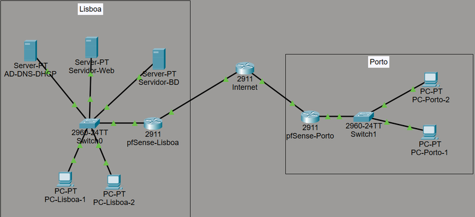
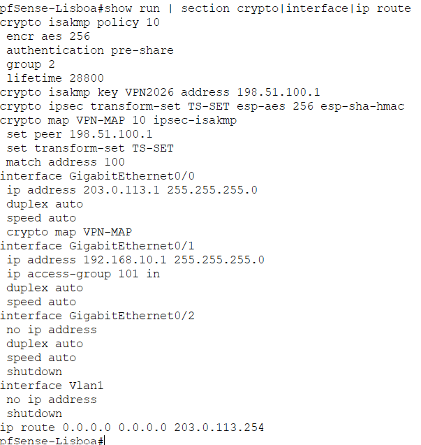
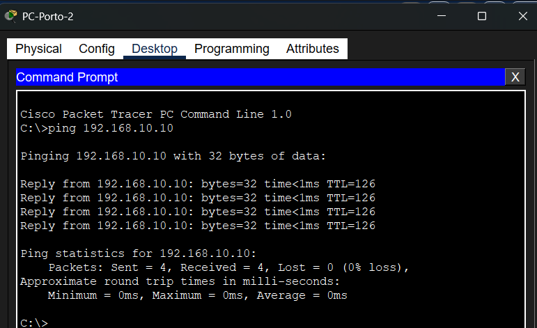
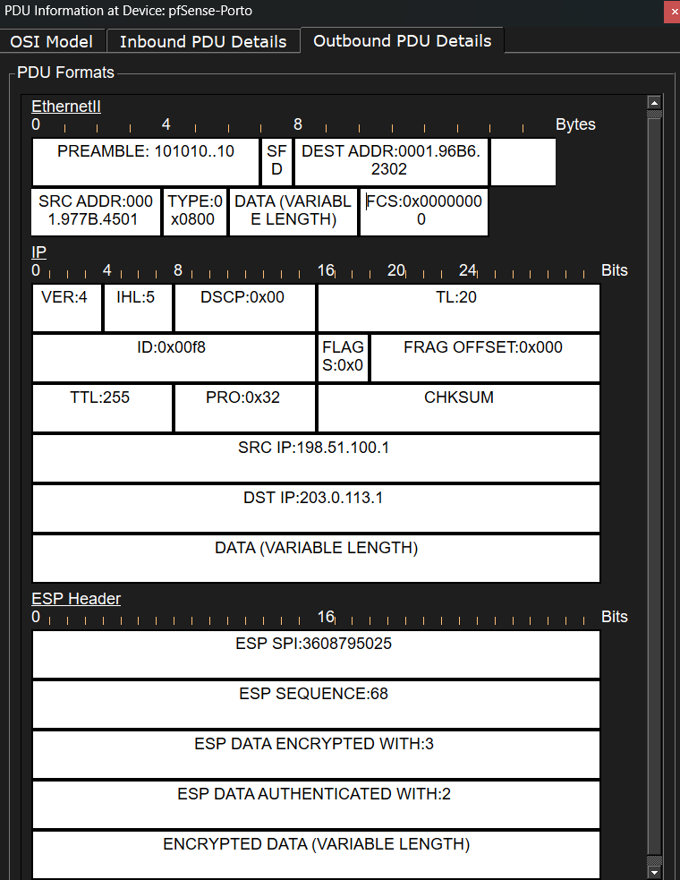
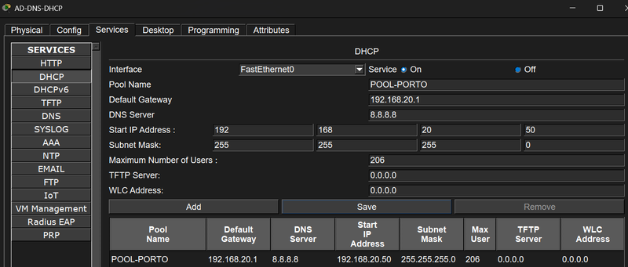
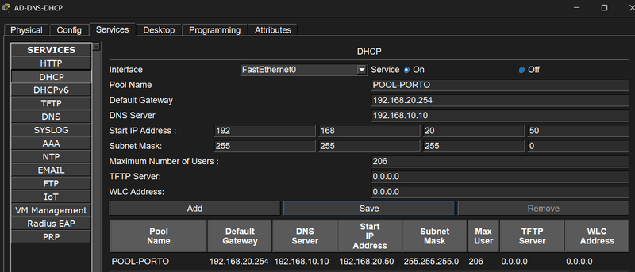

# VPN Site-to-Site

**Responsável técnica:** Alexandra Carneiro (Técnica de Redes e Segurança)

Ligar a sede de uma empresa (Lisboa) à sua filial (Porto) com um túnel VPN IPsec Site-to-Site, para que a filial aceda em segurança aos serviços centrais: Active Directory, DNS, DHCP, servidor web interno, base de dados e partilhas de ficheiros.

Empresa fictícia: TechSolutions. Ambiente simulado em Cisco Packet Tracer.

*Topologia da rede: sede em Lisboa (servidores, switch e gateway pfSense) ligada à filial no Porto (gateway pfSense, switch e postos de trabalho) por um túnel VPN IPsec.*

## Endereçamento

| Local | Rede | Gateway |
| --- | --- | --- |
| Sede (Lisboa) | 192.168.10.0/24 | 192.168.10.1 |
| Filial (Porto) | 192.168.20.0/24 | 192.168.20.1 |
| Servidor central (AD/DNS/DHCP/SMB) | 192.168.10.10 | - |
| Servidor web (intranet) | 192.168.10.20 | - |
| Servidor de base de dados | 192.168.10.30 | - |
| PC-Lisboa-1 / PC-Lisboa-2 | 192.168.10.50 / .51 | 192.168.10.1 |
| PC-Porto-1 / PC-Porto-2 | 192.168.20.50 / .51 | 192.168.20.1 |

WAN da sede: 203.0.113.1 (router do ISP 203.0.113.254). WAN da filial: 198.51.100.1 (router do ISP 198.51.100.254).

O DHCP é centralizado no servidor 192.168.10.10 (Option 3 gateway, Option 6 DNS) para os postos das duas localizações, e o DNS também é centralizado em 192.168.10.10 (por exemplo, intranet.local resolve para 192.168.10.10). Toda a comunicação entre o Porto e Lisboa passa pelo túnel VPN.

Nota: no Packet Tracer, os gateways pfSense/UDM-Pro são representados por routers Cisco 2911 e os switches por 2960-24TT. O equipamento real previsto é pfSense/UDM-Pro nos gateways, Cisco Catalyst 2960 na sede e Ubiquiti USW-24-POE no Porto.

## O túnel VPN

| Parâmetro | Valor |
| --- | --- |
| Protocolo | IPsec, IKEv1 |
| Autenticação | Chave pré-partilhada (PSK) |
| Encriptação Fase 1 | AES-256 |
| Hash Fase 1 | SHA-1 |
| Grupo Diffie-Hellman | 5 (1536-bit MODP) |
| Fase 2 | ESP, modo Tunnel, esp-aes 256 + esp-sha-hmac |
| Perfect Forward Secrecy | Ativo, grupo 5 |
| Tráfego protegido | 192.168.10.0/24 <-> 192.168.20.0/24 |

*Configuração do túnel no pfSense-Lisboa: política ISAKMP, chave pré-partilhada, transform-set e interfaces.*

A chave pré-partilhada que aparece na documentação é um exemplo de laboratório, não uma credencial real.

Sobre a criptografia: o NIST recomenda DH grupo 14 e SHA-256 para produção real, mas o Packet Tracer limita a negociação ao grupo 5 e a SHA-1. Foram usados DH grupo 5 e SHA-1, o nível mais alto suportado pelo simulador.

## As 7 fases

1. **Análise técnica da infraestrutura** - levantamento dos equipamentos e dos serviços centrais, tabela de endereçamento IP estático e desenho da topologia. Sem encriptação, as credenciais do Active Directory, as consultas à base de dados e os ficheiros SMB entre as duas localizações ficariam expostos na Internet pública. A VPN garante confidencialidade, integridade e autenticidade.
2. **Plano de intervenção** - janela de manutenção de sexta 20:00 a sábado 14:30, com pausa noturna obrigatória das 23:00 às 08:30. Cronograma: 20:00-20:30 arranque e configuração das interfaces e rotas; 20:30-21:30 configuração do túnel nos dois lados; 21:30-22:30 regras de firewall iniciais e testes básicos; 22:30-23:00 ponto de decisão Go/No-Go; sábado 08:30-11:30 testes aplicacionais; 11:30-14:30 diagnóstico e resolução de incidentes; 14:30 encerramento e validação com utilizadores-piloto. Riscos previstos: perda de acesso remoto às gateways, incompatibilidade de parâmetros IKE/IPsec, firewall a bloquear tráfego legítimo e fadiga técnica. Rollback diferenciado: na sede, restauro do backup `sede_pfsense_backup_pre_vpn.xml` em cerca de 15 minutos; na filial, shutdown da interface WAN em cerca de 10 minutos.
3. **Configuração e implementação** - túnel IPsec/IKE entre os dois gateways, com a configuração ativa aplicada nos dois lados. Validação: ISAKMP SA no estado QM_IDLE, contadores ESP de encriptação e desencriptação, ping bidirecional Lisboa-Porto com 0% de perda e acesso web ao servidor central.
4. **Testes e validação** - matriz de 9 testes, todos aprovados (ver tabela abaixo).
5. **Incidentes** - 5 incidentes diagnosticados e resolvidos (ver tabela abaixo).
6. **Gestão da intervenção** - métricas previsto vs. real, riscos e aprovação formal. A intervenção durou mais 3 horas do que o previsto por causa do diagnóstico e da resolução dos 5 incidentes; o desvio foi absorvido pela margem de contingência de 4 horas. Ponto de decisão Go/No-Go no sábado às 12:30.
7. **Relatório final consolidado** - sumário executivo, arquitetura, testes e troubleshooting. Regras de firewall finais: UDP 500 (IKE), UDP 4500 (NAT-T), IP Protocol 50 (ESP), ICMP entre as duas redes, DNS porta 53 e SMB portas 445/139 para 192.168.10.10. Recomendações: monitorização SNMP/Syslog dos gateways e auditorias semestrais às chaves PSK.

O documento consolidado com as 7 fases é o `VPN-Site-to-Site-Lisboa-Porto.pdf`. Cada fase também está em separado na pasta `fases/`.

## Testes (9, todos aprovados)

| ID | Teste | Ferramenta | Origem e destino | Resultado |
| --- | --- | --- | --- | --- |
| TC01 | Validação de IP e gateway | ipconfig /all | PC-Porto-1 (192.168.20.50) | IP, gateway e DNS corretos (DNS 192.168.10.10) |
| TC02 | Conectividade ICMP | ping | PC-Porto-2 (192.168.20.51) para o servidor de Lisboa (192.168.10.10) | 0% de perda de pacotes |
| TC03 | Rastreio de rota VPN | tracert | PC-Porto-1 para 192.168.10.10 e 192.168.10.50 | Encaminhado pelo túnel |
| TC04 | Resolução de nomes DNS | nslookup | PC-Porto-1 para 192.168.10.10 | intranet.local resolve para 192.168.10.10 |
| TC05 | Acesso ao servidor web | browser HTTP | PC-Porto-1 para 192.168.10.20 | Página renderizada |
| TC06 | Acesso a posto de Lisboa | ping / TCP Test | PC-Porto-1 para 192.168.10.50 | Resposta do host |
| TC07 | Acesso a partilhas | SMB | PC-Porto-1 para 192.168.10.10 | Sessão SMB ativa |
| TC08 | Auditoria de pacotes ESP | Inspeção PDU | Gateway do Porto (WAN) | Tráfego encriptado ESP |
| TC09 | Conectividade ao servidor de BD | ping | PC-Porto-1 para 192.168.10.30 | Aprovado |

O ipconfig confirmou o IP 192.168.20.50, o gateway 192.168.20.1 e o DNS/DHCP 192.168.10.10 nos postos da filial. A inspeção de pacotes na interface WAN confirmou que ICMP, HTTP e DNS circulam encriptados e encapsulados em ESP.

*Ping do PC-Porto-2 para 192.168.10.10, com 0% de perda de pacotes (TC02).*

*Inspeção de pacotes na interface WAN do pfSense-Porto: o tráfego circula encriptado em ESP (TC08).*

## Os 5 incidentes

| # | Problema | Causa | Solução |
| --- | --- | --- | --- |
| 1 | A negociação IKE Fase 1 falhava de imediato, sem túnel | Chave pré-partilhada diferente nos dois gateways: `VPN2026` em Lisboa, `vpn2026` no Porto (maiúsculas vs. minúsculas) | Uniformizar a chave para `VPN2026` nos dois lados |
| 2 | A Fase 2 IPsec não estabelecia, tráfego sem encapsular | ACL crypto em Lisboa a apontar para a rede errada (192.168.30.0 em vez de 192.168.20.0) | Corrigir a sub-rede remota na ACL |
| 3 | Túnel ativo mas sem acesso a serviços | Firewall só permitia HTTPS (porta 443) | Permitir ICMP, DNS (53) e SMB (445/139) |
| 4 | Filial não resolve nomes internos (intranet.local) | DHCP a distribuir o DNS público 8.8.8.8 (Option 6) | Option 6 com o DNS interno (192.168.10.10) |
| 5 | Filial sem rota de saída, VPN inacessível | DHCP a distribuir um gateway inexistente (192.168.20.254, Option 3) | Option 3 com o gateway correto (192.168.20.1) |

Cada incidente tem o seu ficheiro Packet Tracer na pasta `packet-tracer/`, com o problema reproduzido e a correção aplicada. A validação de cada correção foi feita com `show crypto isakmp sa`, `show crypto ipsec sa`, ping e nslookup.

*Incidente 4: o DHCP do pool POOL-PORTO distribuía o DNS público 8.8.8.8 em vez do DNS interno.*

*Incidente 5: o DHCP distribuía o gateway inexistente 192.168.20.254 em vez de 192.168.20.1.*

Dimensionamento: 40 patch cords (20 curtos de 0,5m para a conectorização interna no bastidor entre o patch panel e o switch, 20 longos de 3m para ligar as tomadas murais aos postos). A filial ficou dimensionada para suportar até 20 dispositivos (10 tomadas duplas RJ45 Cat6 com cablagem redundante entre bastidor e áreas de trabalho).

## Ficheiros

- `VPN-Site-to-Site-Lisboa-Porto.pdf` - documento consolidado das 7 fases
- `fases/` - cada fase em PDF separado
- `packet-tracer/` - topologia principal (`VPN-Site-to-Site.pkt`) e um ficheiro por incidente
- `topologia.png` - imagem da topologia da rede

Para abrir os ficheiros `.pkt` é preciso o Cisco Packet Tracer (gratuito com conta NetAcad).

## Notas

- Projeto em ambiente simulado. A empresa, os endereços IP públicos e os dados são fictícios.
- Os parâmetros de criptografia (grupo Diffie-Hellman 5, SHA-1) são os mais fortes suportados pelo Packet Tracer; em produção real usam-se os recomendados pelo NIST (grupo 14, SHA-256). Isto está explicado na Fase 2.
